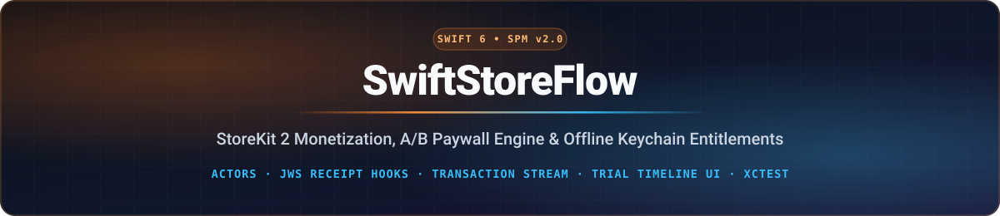
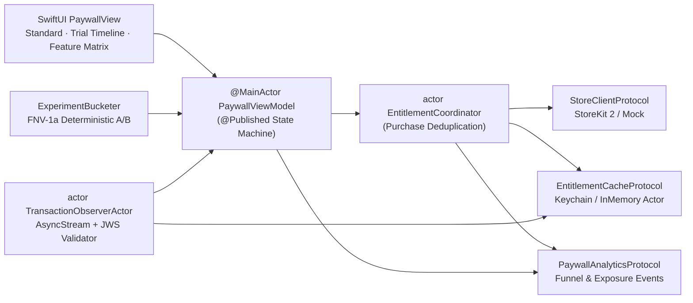

<div align="center">
  
</div>

<p align="center">
  <a href="https://github.com/Bugraciftci/SwiftStoreFlow/actions/workflows/ci.yml"></a>
  <a href="https://github.com/Bugraciftci/SwiftStoreFlow/releases/tag/v2.0.0"></a>
  <a href="https://bugraciftci.github.io/SwiftStoreFlow/documentation/swiftstoreflow/"></a>
  
  
  
  
</p>

Production-grade **Swift 6 & SwiftUI StoreKit 2** monetization, A/B paywall experimentation, and offline-first Keychain entitlement architecture extracted from commercial App Store apps.

> 📚 **Interactive API Reference:** [SwiftStoreFlow DocC Documentation](https://bugraciftci.github.io/SwiftStoreFlow/documentation/swiftstoreflow/)

## Architecture



## What's Inside (v2.0)

- **Rich Subscription Lifecycle Models (`SubscriptionLifecycle.swift`):** Models `RenewalState` (`subscribed`, `inGracePeriod`, `inBillingRetry`, `expired`, `revoked`), `PromotionalOfferMetadata` (introductory trials, win-back offers), `SubscriptionReceiptSnapshot` (JWS), and `RevenueMetricsSnapshot`.
- **Deterministic A/B Paywall Engine (`ExperimentBucketer.swift`):** Stateless 64-bit FNV-1a bucketing with weighted variants, holdout cohorts, QA/TestFlight overrides, and automatic exposure tracking.
- **Live Transaction Stream & JWS Validation (`TransactionObserverActor.swift`):** Multi-consumer `AsyncStream<EntitlementUpdateEvent>` bridging StoreKit 2 updates through a pluggable `ReceiptValidatorProtocol` with `.strictOnline` or `.allowCachedGraceWindow` offline policies.
- **3 Adaptive SwiftUI Paywall Templates:** `StandardCards`, `TrialTimelineView` (Day 1 → Reminder → Billing), and `FeatureComparisonMatrixView` + animated `PaywallSkeletonView` and billing-retry alert banner.
- **Churn Recovery & Win-Back Engine (`WinbackOfferEngine.swift`, `PaywallAnalyticsInspectorView.swift`):** Deterministic offer recommendation engine for auto-renew cancellations, billing retry bridges, and recent vs. deep lapsed subscribers, paired with a Chi-Square Sample Ratio Mismatch (SRM) guard and SwiftUI A/B telemetry overlay.
- **Strict Swift 6 Concurrency:** Full `Sendable` value types, actor-isolated purchase deduplication, Keychain storage (`kSecAttrAccessibleAfterFirstUnlockThisDeviceOnly`), and zero data-race warnings.

## Quick Usage

```swift
import SwiftUI
import SwiftStoreFlow

let experiment = PaywallExperiment(
    experimentID: "onboarding_paywall_v2",
    variants: [
        PaywallExperimentVariant(id: "control", weight: 50, templateStyle: .standardCards),
        PaywallExperimentVariant(id: "timeline", weight: 50, templateStyle: .trialTimeline, headline: "Try 7 Days Free")
    ],
    holdoutPercentage: 0.10
)

@MainActor
struct AppRootView: View {
    @StateObject private var viewModel = PaywallViewModel(
        coordinator: EntitlementCoordinator(
            client: StoreKitClient(tierMapping: ["app.pro.yearly": .pro]),
            cache: KeychainEntitlementCache()
        ),
        productIDs: ["app.pro.monthly", "app.pro.yearly"],
        experiment: experiment,
        userID: "user-12345"
    )

    var body: some View {
        ProWorkspaceView()
            .requiresEntitlement(viewModel.entitlement, tier: .pro) {
                PaywallView(viewModel: viewModel)
            }
    }
}
```

## Running Tests & Benchmarks

26 XCTest cases covering actor-isolated purchase deduplication (12-task contention stress test), 10k-iteration FNV-1a bucketing determinism, Keychain offline entitlements, Win-Back offer rules, and Chi-Square SRM detection:

```bash
swift test --enable-code-coverage
```

## License

MIT — see [LICENSE](./LICENSE).
