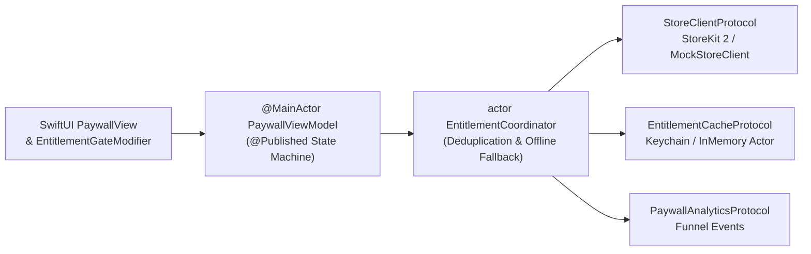

# SwiftStoreFlow

[](https://swift.org)
[](https://developer.apple.com)
[](./LICENSE)

Production-grade **Swift 6 & SwiftUI StoreKit 2** monetization and entitlement architecture extracted from commercial App Store apps. Built with strict concurrency (`Sendable`, `actor`, `async/await`), protocol-oriented MVVM, Keychain-backed offline fallback, and deterministic `XCTest` coverage.

## Architecture



## Key Engineering Highlights

- **Strict Swift 6 Concurrency:** Full `Sendable` value types, `actor`-isolated `EntitlementCoordinator`, and `@MainActor` MVVM state management with zero data races.
- **Re-Entrancy Protection:** Guards against double-tap purchase races with deterministic `.purchaseInProgress` rejection.
- **Offline-First Keychain Entitlements:** Encrypted device-only `KeychainEntitlementCache` (`kSecAttrAccessibleAfterFirstUnlockThisDeviceOnly`) ensures paying users retain access offline.
- **Protocol-Oriented Testability:** Every StoreKit 2, Keychain, and analytics boundary is protocol-abstracted for fast, sandbox-free `swift test` execution.
- **Adaptive SwiftUI Components:** `PaywallView`, `PlanOptionCard`, and `.requiresEntitlement(...)` supporting Dark Mode, Dynamic Type, SF Symbols, and VoiceOver.

## Quick Usage

```swift
import SwiftUI
import SwiftStoreFlow

struct AppRootView: View {
    @StateObject private var viewModel = PaywallViewModel(
        coordinator: EntitlementCoordinator(
            client: StoreKitClient(tierMapping: ["app.pro.yearly": .pro]),
            cache: KeychainEntitlementCache()
        ),
        productIDs: ["app.pro.monthly", "app.pro.yearly"],
        placement: "onboarding"
    )

    var body: some View {
        ProWorkspaceView()
            .requiresEntitlement(viewModel.entitlement, tier: .pro) {
                PaywallView(viewModel: viewModel)
            }
    }
}
```

## Installation (Swift Package Manager)

```swift
dependencies: [
    .package(url: "https://github.com/Bugraciftci/SwiftStoreFlow.git", from: "1.0.0")
]
```

## Running Tests

```bash
swift test
```

## License

MIT — see [LICENSE](./LICENSE).
